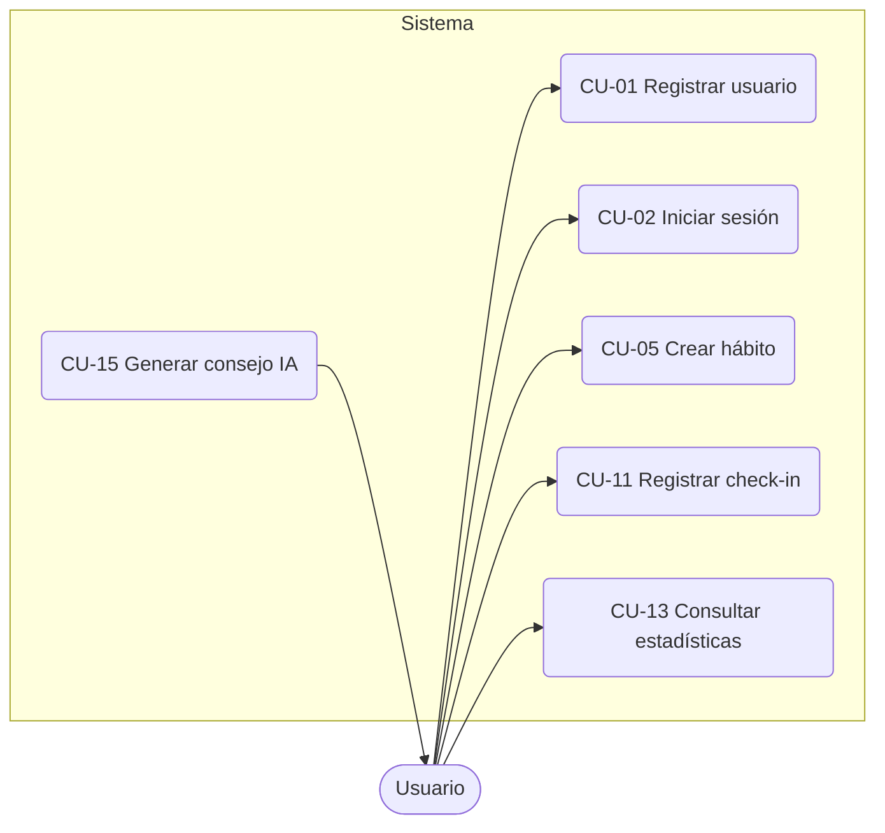

# SRS DE HÁBITOS SALUDABLES

**Presentado por:** DIANA KATERINE PÉREZ GUALY  
**Programa de Formación:** Tecnólogo de Análisis y Desarrollo de Software  
**Ficha:** 3413988  
**Presentado a:** JAVIER HUMBERTO PINTO  
**Institución:** Servicio Nacional de Aprendizaje – SENA  
**Centro:** Centro de la Industria, la Empresa y los Servicios  
**Regional:** Regional Huila (Neiva - Huila)  
**Año:** 2026  

---

## TABLA DE CONTENIDO

- [1. INTRODUCCIÓN](#1-introducción)
  - [1.1. Planteamiento del Problema](#11-planteamiento-del-problema)
  - [1.2. Propósito](#12-propósito)
  - [1.3. Justificación](#13-justificación)
  - [1.4. Objetivo General](#14-objetivo-general)
    - [1.4.1. Objetivos Específicos](#141-objetivos-específicos)
  - [1.5. Alcance y Límites](#15-alcance-y-límites)
  - [1.6. Personal Involucrado](#16-personal-involucrado)
  - [1.7. Definiciones, Acrónimos y Abreviaturas](#17-definiciones-acrónimos-y-abreviaturas)
  - [1.8. Resumen](#18-resumen)
- [2. DESCRIPCIÓN GENERAL](#2-descripción-general)
  - [2.1. Perspectiva del Producto](#21-perspectiva-del-producto)
  - [2.2. Características de los Usuarios](#22-características-de-los-usuarios)
  - [2.3. Restricciones](#23-restricciones)
  - [2.4. Suposiciones y Dependencias](#24-suposiciones-y-dependencias)
- [3. REQUISITOS ESPECÍFICOS](#3-requisitos-específicos)
  - [3.1. Requisitos Comunes de las Interfaces](#31-requisitos-comunes-de-las-interfaces)
    - [3.1.1. Interfaces de usuario](#311-interfaces-de-usuario)
    - [3.1.2. Interfaces de hardware](#312-interfaces-de-hardware)
    - [3.1.3. Interfaces de software](#313-interfaces-de-software)
    - [3.1.4. Interfaces de comunicación](#314-interfaces-de-comunicación)
  - [3.2. Historias de Usuario](#32-historias-de-usuario)
  - [3.3. Requerimientos Funcionales](#33-requerimientos-funcionales)
  - [3.4. Requerimientos No Funcionales](#34-requerimientos-no-funcionales)
  - [3.5. Casos de Uso](#35-casos-de-uso)

---

## 1. INTRODUCCIÓN

Mantener un estilo de vida saludable en la actualidad representa uno de los principales desafíos para las personas, debido al ritmo de vida acelerado, el sedentarismo y las múltiples obligaciones diarias. En el día a día, la intención de mejorar hábitos básicos como la hidratación, la actividad física o el descanso suele chocar con la falta de organización y motivación, lo que genera que los buenos propósitos se abandonen a las pocas semanas de haber iniciado.

Como respuesta a esta problemática, durante los últimos años han surgido diversas aplicaciones enfocadas en la salud y el fitness. Sin embargo, gran parte de estas soluciones comerciales presentan limitaciones prácticas para el usuario común: obligan a utilizar múltiples plataformas desconectadas (una aplicación para registrar el agua, otra distinta para el ejercicio), tienen interfaces complejas o simplemente actúan como bases de datos pasivas que guardan números, pero no brindan retroalimentación ni apoyo cuando la persona empieza a perder la constancia.

En este contexto, el presente proyecto propone el desarrollo de un sistema integrado de "Aplicación de Hábitos Saludables", un aplicativo web que se usa desde el navegador del celular o del computador. Esta solución tecnológica busca centralizar el registro diario de actividades en una interfaz única, rápida y amigable, incorporando además un motor de Inteligencia Artificial (IA) capaz de analizar el progreso semanal del usuario para generar consejos personalizados y motivacionales. De esta manera, se plantea un prototipo funcional y accesible que no solo se limite a registrar datos, sino que actúe como un compañero digital para ayudar a mejorar la calidad de vida y la retención de los buenos hábitos.

### 1.1. PLANTEAMIENTO DEL PROBLEMA
Hoy en día, con el ritmo de vida tan rápido y las múltiples obligaciones diarias, resulta muy difícil para las personas mantener un estilo de vida saludable. Aunque existe un gran deseo por hacer más ejercicio, mejorar la hidratación y cuidarse en general, la mayoría termina rindiéndose a los pocos días o semanas de haber empezado. El motivo principal de este fracaso es que llevar el control de estos buenos hábitos se vuelve una tarea complicada y aburrida. Las personas intentan recordar sus avances de memoria o terminan usando muchas aplicaciones diferentes al mismo tiempo: una para contar los vasos de agua, otra para el ejercicio y una más para otros hábitos. Tener que usar tantas herramientas distintas resulta pesado y hace que la gente pierda el interés rápidamente.

Además, las aplicaciones comunes solo sirven para guardar información, pero no ofrecen apoyo, palabras de ánimo ni consejos útiles cuando la persona empieza a fallar en sus metas. Como resultado, el usuario se desmotiva y abandona por completo sus objetivos de salud.

### 1.2. PROPÓSITO
El propósito de este proyecto es transformar la manera en que las personas construyen sus rutinas diarias, pasando de un proceso aburrido y desorganizado a una experiencia motivadora. Se busca ofrecer a los usuarios un "compañero digital" que no solo sirva para anotar lo que hicieron en el día, sino que los entienda, les celebre sus pequeños logros y les ofrezca una guía amigable para que logren mantener un estilo de vida saludable a largo plazo sin sentirse abrumados.

### 1.3. JUSTIFICACIÓN
Construir hábitos saludables es fundamental para prevenir enfermedades, tener más energía y mejorar el estado de ánimo. Sin embargo, la frustración que sienten las personas al no poder cumplir sus metas de salud afecta su autoestima. Este proyecto es importante y se justifica porque resuelve un problema real del día a día: la falta de constancia. Al centralizar todo (agua, ejercicio, lectura, etc.) en una sola aplicación amigable, se le ahorra tiempo y esfuerzo al usuario.

Además, el gran valor agregado de este proyecto es la incorporación de Inteligencia Artificial; en lugar de dejar al usuario solo con sus números, la aplicación le hablará, le dará ánimos y le sugerirá pequeños cambios, haciendo que la tecnología actúe como un motivador personal accesible para cualquier persona que tenga un celular con navegador web y conexión a internet.

### 1.4. OBJETIVO GENERAL
Desarrollar un aplicativo web amigable y fácil de usar que permita a las personas registrar y llevar el control de sus hábitos diarios (como hidratación y actividad física) en un solo lugar, integrando un asistente de inteligencia artificial que brinde consejos personalizados para mantenerlos motivados en el cumplimiento de sus metas.

#### 1.4.1. OBJETIVOS ESPECÍFICOS
- Analizar los desafíos y las limitaciones que enfrentan las personas al intentar mantener hábitos saludables utilizando métodos tradicionales o aplicaciones fragmentadas.
- Diseñar una interfaz de usuario intuitiva y minimalista que permita realizar el registro diario de hábitos (check-in) de forma rápida y sin complicaciones.
- Diseñar la arquitectura del sistema y el modelo de base de datos relacional para gestionar de forma segura la información de los usuarios, sus metas y su progreso diario.
- Implementar el módulo de seguimiento y control para que el usuario pueda crear hábitos personalizados y marcar sus actividades cumplidas cada día.
- Desarrollar un módulo de estadísticas que calcule y muestre gráficamente el nivel de cumplimiento y las rachas de días consecutivos del usuario.
- Integrar un motor de Inteligencia Artificial capaz de analizar el historial semanal del usuario para generar consejos de texto motivacionales orientados a evitar el abandono de sus metas.
- Evaluar la usabilidad y el impacto de la aplicación en la motivación del usuario mediante pruebas de funcionamiento del prototipo.

### 1.5. ALCANCE Y LÍMITES
**Alcances:**
El alcance de este proyecto abarca el diseño, desarrollo e implementación de la totalidad de la "Aplicación de Hábitos Saludables", garantizando el funcionamiento integral de todos sus módulos. Las funcionalidades obligatorias son:
- **Gestión de cuentas:** Registro, inicio de sesión, recuperación de contraseña y administración del perfil personal del usuario de forma segura.
- **Configuración de metas:** Creación, edición, categorización, pausa y eliminación de hábitos diarios (ej. litros de agua o minutos de ejercicio).
- **Registro diario (Check-in):** Interfaz centralizada y rápida para marcar y desmarcar actividades cumplidas día a día con un solo toque.
- **Módulo de estadísticas:** Cálculo automático de rachas consecutivas, gráficos de progreso y consulta de calendario histórico.
- **Asistente de Inteligencia Artificial:** Análisis del historial de cumplimiento para generar consejos motivacionales y sugerencias de mejora con historial de mensajes.
- **Personalización:** Recordatorios diarios locales del navegador y modo oscuro de la interfaz.

**Límites y Restricciones del Sistema:**
- No se sincronizará automáticamente con dispositivos de hardware físico (smartwatches o pulseras de actividad). El registro es manual por el usuario.
- Las recomendaciones de la IA tienen enfoque motivacional y de bienestar general; nunca emitirán diagnósticos médicos, dietas clínicas ni rutinas de rehabilitación.
- Requiere conexión a internet para autenticación y consultas a la API de IA.
- Es un aplicativo web accesible por navegador; no contempla desarrollo de app móvil nativa en Android o iOS.

### 1.6. PERSONAL INVOLUCRADO

| Nombre | Rol | Categoría Profesional | Responsabilidad | Información de Contacto |
| :--- | :--- | :--- | :--- | :--- |
| **Diana Katerine Pérez Gualy** | Líder | Aprendiz Tecnólogo ADSO | Levantamiento de requisitos, análisis del sistema, coordinación y elaboración del documento SRS. | dianakaterineperezgualy@gmail.com |
| **Diana Katerine Pérez Gualy** | Programador | Aprendiz Tecnólogo ADSO | Programación de la lógica de negocio, gestión de base de datos, desarrollo de APIs y módulos. | dianakaterineperezgualy@gmail.com |
| **Diana Katerine Pérez Gualy** | Diseñador | Aprendiz Tecnólogo ADSO | Diseño UX/UI, prototipado de pantallas, implementación de interfaz y validación de experiencia. | dianakaterineperezgualy@gmail.com |

### 1.7. DEFINICIONES, ACRÓNIMOS Y ABREVIATURAS

| Término / Acrónimo | Definición |
| :--- | :--- |
| **SRS** | Especificación de Requisitos de Software (Software Requirements Specification). |
| **Aplicativo web** | Aplicación accesible vía navegador web sin necesidad de instalación nativa. |
| **IA** | Inteligencia Artificial; tecnología que analiza datos para redactar consejos de asistencia. |
| **API** | Interfaz de programación de aplicaciones para comunicarse con servicios externos. |
| **MySQL / SQLite** | Sistema de gestión de bases de datos relacional para usuarios, hábitos y progresos. |
| **UI / UX** | Interfaz de Usuario y Experiencia de Usuario; diseño visual e interactivo. |
| **Dashboard** | Pantalla principal o tablero de control con resumen del día, gráficos y tareas. |
| **Backend** | Capa lógica y servidor encargado de almacenar datos y procesar lógica de negocio. |
| **Frontend** | Capa de presentación visual interactiva ejecutada en el navegador. |
| **HTTPS** | Protocolo seguro de comunicación cifrada en tránsito. |
| **JSON** | Formato ligero de intercambio de datos estructurados. |
| **Token de acceso** | Credencial de seguridad (JWT) emitida tras autenticación exitosa. |
| **Hash (bcrypt / scrypt)** | Algoritmo criptográfico unidireccional para resguardo de contraseñas. |
| **Notificación local** | Alerta emitida directamente por el navegador del dispositivo con permiso del usuario. |
| **Hábito** | Actividad saludable recurrente que el usuario planifica y registra. |
| **Categoría** | Clasificación temática (Físico, Nutrición, Mental). |
| **Racha (Streak)** | Conteo de días consecutivos con cumplimiento total de hábitos programados. |
| **Check-in** | Acción de confirmar el cumplimiento de una meta diaria con un toque. |
| **Borrado lógico** | Desactivación u ocultamiento de un registro conservando integridad histórica. |
| **Ley 1581 de 2012** | Marco legal colombiano de protección y tratamiento de datos personales. |

### 1.8. RESUMEN
Este documento formaliza la Especificación de Requisitos de Software del proyecto "Aplicación de Hábitos Saludables", estructurado bajo estándares IEEE 830. Define requerimientos funcionales, no funcionales, historias de usuario y casos de uso detallados para un aplicativo web responsivo con backend relacional, arquitectura modular e integración con IA motivacional.

---

## 2. DESCRIPCIÓN GENERAL

### 2.1. PERSPECTIVA DEL PRODUCTO
La "Aplicación de Hábitos Saludables" es una plataforma digital integral e independiente diseñada para centralizar hábitos, hidratación y bienestar. Se estructura en una arquitectura por capas: presentación (Frontend SPA), capa lógica y de servicios (Backend REST) y base de datos relacional persistente, con integración a APIs de Inteligencia Artificial y mensajería.

### 2.2. CARACTERÍSTICAS DE LOS USUARIOS
- **Usuario final (Cliente):** Personas de diversas edades y ocupaciones que desean mejorar su salud y bienestar personal. Requieren una experiencia ágil, check-in veloz (menor a 5 segundos), gráficos claros y mensajes de aliento sin fricciones técnicas.

### 2.3. RESTRICCIONES
- Requiere acceso a internet para registro, sincronización y generación de pronósticos de IA.
- Cumplimiento de la Ley 1581 de 2012 de Protección de Datos Personales de Colombia.
- No incluye sincronización con hardware externo en esta etapa.
- Tiempos de respuesta de base de datos optimizados para carga rápida de estadísticas.
- Recordatorios supeditados a los permisos locales concedidos al navegador.

### 2.4. SUPOSICIONES Y DEPENDENCIAS
- **Dispositivo:** Navegador web moderno con soporte para JavaScript y APIs web estándar.
- **Persistencia:** Servidor de base de datos relacional en línea y funcional.
- **Inteligencia Artificial:** Servicio de API de IA disponible; en caso de caída o desconexión, el sistema recurre a frases motivacionales de respaldo precargadas.
- **Servicio de correo:** Proveedor SMTP para notificaciones de confirmación y recuperación.

---

## 3. REQUISITOS ESPECÍFICOS

### 3.1. REQUISITOS COMUNES DE LAS INTERFACES

#### 3.1.1. Interfaces de usuario
- **Diseño adaptable:** Interfaz responsiva que escala óptimamente a móviles, tablets y ordenadores de escritorio.
- **Respuesta visual:** Marcación instantánea del check-in (menos de 2 segundos) con transiciones suaves.
- **Mensajes comprensibles:** Notificaciones y alertas en lenguaje amigable y sin jerga técnica opaca.
- **Accesibilidad:** Paleta de contrastes suaves, botones amplios y soporte para Modo Oscuro.

#### 3.1.2. Interfaces de hardware
- Entrada manual táctil o por teclado/ratón. No requiere sensores de hardware dedicados.

#### 3.1.3. Interfaces de software
- Base de datos relacional para persistencia de datos.
- Servidor Backend RESTful en Node.js/Express.
- API externa de Inteligencia Artificial (Google Gemini API).
- Servicio externo de correo electrónico y API de notificaciones locales de navegador.

#### 3.1.4. Interfaces de comunicación
- Cifrado seguro HTTPS/TLS para todas las conexiones.
- Protocolo REST con intercambio de información en formato JSON.

---

### 3.2. HISTORIAS DE USUARIO ORGANIZADAS POR MÓDULOS

A continuación se presentan las historias de usuario agrupadas en sus módulos funcionales correspondientes, facilitando la planificación, trazabilidad y ejecución del proyecto:

#### Módulo 1: Autenticación, Seguridad y Gestión de Cuenta
Este módulo abarca el control de acceso, registro, verificación de credenciales, seguridad y administración del perfil del usuario.

| ID | Historia de Usuario | Criterios de Validación | Valor / Prioridad / Estimación |
| :--- | :--- | :--- | :--- |
| **#1** | **Registro de usuario nuevo:** Como usuario nuevo quiero registrarme con mi nombre, correo y contraseña para crear un perfil único donde guardar mi progreso. | • Validación de formato de campos. • Correo único en base de datos. • Contraseña $\ge$ 6 caracteres cifrada con hash (bcrypt/scrypt). • Rol asignado "Usuario". • Correo de confirmación con tolerancia a fallas. | **Valor:** Alto **Prioridad:** Alta **Estimación:** 3 días |
| **#2** | **Inicio de sesión:** Como usuario quiero ingresar con mi correo y contraseña para acceder a mi panel diario de hábitos de forma segura. | • Autenticación contra base de datos. • Mensaje genérico ante credenciales incorrectas. • Generación de token JWT de acceso. • Redirección inmediata al Dashboard. • Enlace visible a recuperación de clave. | **Valor:** Alto **Prioridad:** Alta **Estimación:** 2 días |
| **#7** | **Recuperación de contraseña:** Como usuario que olvidó su clave quiero solicitar un enlace a mi correo para restablecer mi acceso. | • Mensaje neutro de confirmación protegiendo la existencia del correo. • Código o token temporal de un solo uso. • Cifrado de la nueva contraseña. | **Valor:** Alto **Prioridad:** Alta **Estimación:** 3 días |
| **#8** | **Edición del perfil personal:** Como usuario quiero actualizar mi nombre o foto de perfil para mantener mis datos al día. | • Precarga de datos existentes. • Nombre obligatorio y validación de imagen. • Actualización persistente inmediata. | **Valor:** Medio **Prioridad:** Baja **Estimación:** 2 días |

---

#### Módulo 2: Gestión y Configuración de Hábitos (CRUD y Categorías)
Este módulo gestiona la creación, mantenimiento, categorización y ciclo de vida de los hábitos personalizados del usuario.

| ID | Historia de Usuario | Criterios de Validación | Valor / Prioridad / Estimación |
| :--- | :--- | :--- | :--- |
| **#3** | **Creación de hábito personalizado:** Como usuario activo quiero agregar un nuevo hábito con nombre, meta y categoría para iniciar el seguimiento. | • Campos obligatorios: nombre, meta numérica $> 0$, ícono y categoría. • Relación con el usuario en la base de datos. • Aparición inmediata en el panel del día. | **Valor:** Alto **Prioridad:** Alta **Estimación:** 3 días |
| **#9** | **Edición de hábito existente:** Como usuario quiero modificar los datos de mi hábito para ajustar mis metas si cambian mis exigencias. | • Modificación de título, meta, unidad o categoría. • Los cambios solo aplican a registros futuros, conservando el historial. • Actualización en base de datos. | **Valor:** Alto **Prioridad:** Alta **Estimación:** 3 días |
| **#10** | **Eliminación o pausa de hábito:** Como usuario quiero pausar o eliminar un hábito que ya no realizaré para organizar mi lista. | • Confirmación previa de seguridad. • Borrado lógico (ocultamiento sin perder historial). • Los hábitos pausados no afectan rachas activas. | **Valor:** Alto **Prioridad:** Media **Estimación:** 2 días |
| **#11** | **Categorización de hábitos:** Como usuario quiero asignar una categoría para tener mi panel ordenado por áreas de salud. | • Selector de categorías (Físico, Nutrición, Mental). • Catálogo relacional y agrupación visual en el panel. | **Valor:** Medio **Prioridad:** Baja **Estimación:** 2 días |

---

#### Módulo 3: Seguimiento Diario y Check-in (Panel / Dashboard)
Este módulo comprende la interacción del día a día, permitiendo al usuario registrar o corregir de forma ágil el cumplimiento de sus metas diarias.

| ID | Historia de Usuario | Criterios de Validación | Valor / Prioridad / Estimación |
| :--- | :--- | :--- | :--- |
| **#4** | **Registro de progreso diario (Check-in):** Como usuario ocupado quiero presionar un botón junto a mi hábito para marcarlo como completado en el día de forma instantánea. | • Cambio visual a completado en $< 2$ segundos. • Registro en tabla de seguimiento con fecha y hora. • Prevención de duplicados del mismo día. • Opción reversible (deshacer). | **Valor:** Alto **Prioridad:** Alta **Estimación:** 4 días |
| **#16** | **Deshacer check-in por error:** Como usuario quiero poder revertir un hábito marcado accidentalmente. | • Reversión inmediata a estado pendiente al tocar hábito completado. • Eliminación del registro diario en base de datos. • Recálculo automático de gráficos y racha. | **Valor:** Alto **Prioridad:** Alta **Estimación:** 2 días |

---

#### Módulo 4: Estadísticas, Progreso Histórico y Visualización
Este módulo calcula indicadores de consistencia, rachas consecutivas y despliega componentes gráficos y calendarios históricos.

| ID | Historia de Usuario | Criterios de Validación | Valor / Prioridad / Estimación |
| :--- | :--- | :--- | :--- |
| **#5** | **Visualización de rachas y estadísticas:** Como usuario quiero ver un gráfico visual y el número de días seguidos cumplidos para sentirme motivado. | • Cálculo exacto de días consecutivos con éxito total. • Reinicio de racha ante días fallidos. • Gráfico circular o de barra de avance diario. | **Valor:** Alto **Prioridad:** Media **Estimación:** 4 días |
| **#12** | **Visualización de calendario histórico:** Como usuario quiero ver un calendario con indicadores de colores para conocer mi constancia mensual. | • Agrupación histórica por fecha. • Puntos indicadores de días exitosos vs. incompletos. • Navegación entre meses pasados. | **Valor:** Alto **Prioridad:** Media **Estimación:** 4 días |

---

#### Módulo 5: Asistente Motivacional e Inteligencia Artificial
Este módulo orquesta la generación de retroalimentación semanal con IA, el repositorio histórico de mensajes y el mecanismo de respaldo.

| ID | Historia de Usuario | Criterios de Validación | Valor / Prioridad / Estimación |
| :--- | :--- | :--- | :--- |
| **#6** | **Generación de consejo mediante IA:** Como usuario quiero recibir un consejo semanal con IA para saber en qué mejorar y mantener el impulso. | • Resumen de cumplimiento semanal anonimizado. • Envío JSON HTTPS a la API de IA. • Enfoque de bienestar general sin recetas médicas. • Frases de respaldo automáticas si la API falla. | **Valor:** Alto **Prioridad:** Media **Estimación:** 5 días |
| **#14** | **Historial de consejos de la IA:** Como usuario quiero acceder a la lista de consejos previos recibidos para releer sugerencias valiosas. | • Almacenamiento de cada mensaje generado. • Listado cronológico descendente. • Opción de eliminar consejos específicos. | **Valor:** Medio **Prioridad:** Baja **Estimación:** 3 días |

---

#### Módulo 6: Personalización, Notificaciones y Experiencia de Usuario
Este módulo engloba las preferencias de interfaz visual (tema) y la programación de recordatorios locales.

| ID | Historia de Usuario | Criterios de Validación | Valor / Prioridad / Estimación |
| :--- | :--- | :--- | :--- |
| **#13** | **Configuración de recordatorios diarios:** Como usuario quiero programar una hora para recibir alertas locales antes de terminar el día. | • Selector de hora en configuración. • Solicitud de permisos del navegador. • Notificación local programada en el cliente. | **Valor:** Alto **Prioridad:** Media **Estimación:** 3 días |
| **#15** | **Modo Oscuro:** Como usuario nocturno quiero cambiar la interfaz a modo oscuro para descansar la vista. | • Conmutador visual instantáneo. • Persistencia local de la preferencia en el dispositivo. | **Valor:** Medio **Prioridad:** Baja **Estimación:** 2 días |

---

### 3.3. REQUERIMIENTOS FUNCIONALES

| ID | Nombre | Tipo / Prioridad / Crítico | Entradas y Salidas | Descripción y Criterios |
| :--- | :--- | :--- | :--- | :--- |
| **RF1** | Registro de usuarios | Necesario Alta **Sí** | **Entrada:** Nombre, Correo, Contraseña ($\ge 6$ caracteres). **Salida:** Usuario insertado en BD con hash, token y mensaje. | Formulario público de registro. Valida duplicados, almacena con hash bcrypt/scrypt y rol 'USER'. |
| **RF2** | Inicio de sesión | Necesario Alta **Sí** | **Entrada:** Correo, Contraseña. **Salida:** Token JWT de acceso y redirección a Dashboard. | Valida credenciales contra la BD. Respuestas genéricas ante errores sin filtrar datos sensibles. |
| **RF3** | Solicitud de recuperación de contraseña | Necesario Alta **Sí** | **Entrada:** Correo registrado. **Salida:** Código/enlace temporal enviado y confirmación neutra. | Genera token de recuperación temporal de un solo uso con vigencia limitada. |
| **RF4** | Restablecimiento de contraseña | Necesario Alta **Sí** | **Entrada:** Token/código temporal, Nueva contraseña. **Salida:** Contraseña cifrada en BD y confirmación. | Valida vigencia del token y actualiza la clave cifrada en la base de datos. |
| **RF5** | Edición de perfil personal | Deseable Baja No | **Entrada:** Nombre, Foto de perfil. **Salida:** Datos de usuario actualizados en BD e interfaz. | Permite modificar datos personales con precarga del estado actual. |
| **RF6** | Creación de hábito personalizado | Necesario Alta **Sí** | **Entrada:** Título, Meta (valor/unidad), Ícono, Categoría. **Salida:** Hábito creado y visible en lista diaria. | Inserta registro en tabla de hábitos vinculado al usuario autenticado. |
| **RF7** | Categorización de hábitos | Deseable Baja No | **Entrada:** Categoría seleccionada (Físico, Nutrición, Mental). **Salida:** Relación guardada y agrupación en Dashboard. | Clasificación temática para filtrado y presentación ordenada en la interfaz. |
| **RF8** | Edición de hábito existente | Necesario Alta **Sí** | **Entrada:** Hábito seleccionado, Nuevos valores de meta/título. **Salida:** Hábito actualizado en BD. | Actualiza configuración futura del hábito respetando integridad de registros previos. |
| **RF9** | Pausa y reactivación de hábito | Necesario Media No | **Entrada:** Hábito seleccionado, Acción pausar/reactivar. **Salida:** Estado actualizado, exclusión/inclusión en racha. | Oculta el hábito del día sin destruir datos históricos ni penalizar la racha. |
| **RF10** | Eliminación lógica de hábito | Necesario Media No | **Entrada:** Hábito seleccionado, Confirmación. **Salida:** Marca `deleted_at`, exclusión permanente de vistas activas. | Soft delete para preservar coherencia histórica y reportes estadísticos. |
| **RF11** | Visualización del Dashboard diario | Necesario Alta **Sí** | **Entrada:** Token de usuario, Fecha actual. **Salida:** Lista de hábitos del día, avance porcentual y racha. | Vista central con lista de tareas, estado de check-in y resumen motivacional. |
| **RF12** | Registro de progreso (Check-in) | Necesario Alta **Sí** | **Entrada:** Toque en hábito activo, Fecha/hora. **Salida:** Registro diario en BD, cambio visual a verde. | Check-in en menos de 2 segundos, inserción única por día y recálculo de estadísticas. |
| **RF13** | Deshacer check-in | Necesario Alta **Sí** | **Entrada:** Toque sobre hábito completado del día. **Salida:** Eliminación de progreso diario, estado pendiente. | Permite corregir marcaciones accidentales recalculando racha y avance diario. |
| **RF14** | Cálculo y visualización de racha | Necesario Media No | **Entrada:** Registros de seguimiento en BD, Fecha actual. **Salida:** Contador de días consecutivos cumplidos. | Algoritmo que evalúa días consecutivos con 100% de hábitos programados cumplidos. |
| **RF15** | Gráfico de cumplimiento diario | Necesario Media No | **Entrada:** Metas activas y check-ins del día. **Salida:** Gráfico circular interactivo de porcentaje. | Representación visual en tiempo real de la fracción de metas completadas. |
| **RF16** | Calendario histórico | Necesario Media No | **Entrada:** Mes seleccionado. **Salida:** Vista mensual con puntos de éxito y omisión. | Permite auditar la constancia mensual y navegar retrospectivamente en el tiempo. |
| **RF17** | Generación de consejo semanal con IA | Necesario Media No | **Entrada:** Historial de cumplimiento de la semana. **Salida:** Consejo motivacional en lenguaje amigable. | Consulta al motor de IA con datos de desempeño para generar retroalimentación de bienestar. |
| **RF18** | Consejo de respaldo ante falla de IA | Necesario Media No | **Entrada:** Detección de error de conexión con la IA. **Salida:** Frase motivacional predeterminada de BD. | Mecanismo de alta disponibilidad y tolerancia a fallos de conectividad. |
| **RF19** | Historial de consejos | Deseable Baja No | **Entrada:** Solicitud de usuario. **Salida:** Listado ordenado cronológicamente de mensajes. | Repositorio de reflexiones y recomendaciones guardadas para el usuario. |
| **RF20** | Eliminación de consejo del historial | Deseable Baja No | **Entrada:** Consejo seleccionado, Confirmación. **Salida:** Registro eliminado de la base de datos. | Mantenimiento del historial personal por decisión del usuario. |
| **RF21** | Configuración de recordatorios | Necesario Media No | **Entrada:** Hora deseada, Permiso del navegador. **Salida:** Preferencia guardada en perfil. | Permite al usuario definir el horario de la alerta diaria para check-in. |
| **RF22** | Envío de notificación local | Necesario Media No | **Entrada:** Hora programada alcanzada, Permiso activo. **Salida:** Notificación local del navegador emitida. | Alerta visual en el dispositivo móvil o de escritorio recordando cumplir metas. |
| **RF23** | Modo oscuro | Deseable Baja No | **Entrada:** Conmutador en configuración. **Salida:** Tema visual oscuro persistente en navegador. | Mejora el confort visual nocturno y conserva la preferencia en sesiones futuras. |

---

### 3.4. REQUERIMIENTOS NO FUNCIONALES

| Código | Nombre | Grado | Especificación Técnica |
| :--- | :--- | :--- | :--- |
| **RNF-01** | Tiempo de carga | Alta | Carga de pantallas principales en un máximo de 2 segundos mediante consultas optimizadas e indexación. |
| **RNF-02** | Respuesta de check-in | Alta | Transición visual y persistencia del check-in en menos de 2 segundos para retroalimentación instantánea. |
| **RNF-03** | Cifrado en tránsito | Alta | Toda la comunicación externa se realiza mediante conexiones seguras HTTPS/TLS. |
| **RNF-04** | Protección de credenciales | Alta | Cifrado seguro de contraseñas (bcrypt/scrypt con salt) y sesiones gobernadas por tokens JWT protegidos. |
| **RNF-05** | Cumplimiento Ley 1581 | Alta | Protección integral de datos personales conforme al marco legal colombiano de habeas data. |
| **RNF-06** | Disponibilidad con respaldo | Alta | Tolerancia a fallos: fallback automático a citas de motivación locales si la API de IA no responde. |
| **RNF-07** | Integridad histórica | Alta | Aplicación de borrado lógico y llaves foráneas para garantizar consistencia e inmutabilidad de logros pasados. |
| **RNF-08** | Usabilidad ágil | Alta | Flujo de registro y check-in operable en menos de 5 segundos, pensado para usuarios no técnicos. |
| **RNF-09** | Diseño responsivo | Alta | Adaptabilidad garantizada en dispositivos móviles, tablets y computadores de escritorio. |
| **RNF-10** | Manejo amigable de errores | Media | Mensajes de excepción comprensibles y accionables en lenguaje natural, evitando códigos de error crudos. |
| **RNF-11** | Accesibilidad visual | Media | Compatibilidad nativa con modo claro y oscuro manteniendo contrastes estandarizados. |
| **RNF-12** | Formato de datos JSON | Media | Protocolos de comunicación interna y de integración estructurados en formato estándar JSON. |
| **RNF-13** | Dependencia de red | Media | Manejo elegante de desconexión sin simular falsas confirmaciones de guardado. |
| **RNF-14** | Enfoque ético de IA | Alta | La IA está acotada a motivación y bienestar general; restringida de emitir diagnósticos médicos o dietas. |
| **RNF-15** | Arquitectura por capas | Media | Separación limpia entre Frontend, API REST Backend, base de datos relacional y servicios externos de IA. |

---

### 3.5. CASOS DE USO

#### CU-01 Registrar usuario nuevo
- **Actores:** Usuario nuevo (principal), Servicio de Correo (secundario).
- **Precondiciones:** No tener sesión activa, conexión a internet disponible, correo no registrado previamente.
- **Flujo Normal:**
  1. El usuario abre el formulario de registro.
  2. Ingresa nombre, correo electrónico y contraseña ($\ge 6$ caracteres).
  3. El sistema valida formato de campos y verifica que el correo no esté duplicado en la base de datos.
  4. El sistema cifra la contraseña (hash seguro) e inserta el usuario con rol 'USER'.
  5. El sistema envía confirmación por correo y muestra mensaje de éxito con redirección a login.
- **Flujos Alternos:**
  - *Campos incompletos:* Resalta campos obligatorios en rojo.
  - *Correo duplicado:* Alerta sobre existencia previa del correo sin registrar duplicado.
  - *Falla en correo:* La cuenta se crea igualmente notificando la incidencia del correo.

#### CU-02 Iniciar sesión
- **Actores:** Usuario (principal).
- **Precondiciones:** Usuario registrado previamente.
- **Flujo Normal:**
  1. El usuario ingresa correo y contraseña en la pantalla de acceso.
  2. El sistema valida las credenciales contra el hash almacenado en la base de datos.
  3. El sistema emite un token JWT de acceso seguro y redirige al Dashboard principal.
- **Flujos Alternos:**
  - *Credenciales inválidas:* Muestra mensaje genérico de error protegiendo los datos.
  - *Olvidó contraseña:* Ofrece enlace directo al flujo de recuperación (CU-03).

#### CU-03 Recuperar contraseña
- **Actores:** Usuario (principal), Servicio de Correo (secundario).
- **Precondiciones:** Cuenta existente y acceso al correo registrado.
- **Flujo Normal:**
  1. El usuario solicita recuperación ingresando su correo.
  2. El sistema genera un código o token temporal de un solo uso y lo envía por correo.
  3. El usuario abre el enlace, ingresa su nueva contraseña y el sistema la actualiza con hash en base de datos.
- **Flujos Alternos:**
  - *Correo inexistente:* Se muestra el mismo mensaje de confirmación neutro para no revelar registros.
  - *Token expirado:* Invita a solicitar un nuevo enlace de recuperación.

#### CU-04 Editar perfil personal
- **Actores:** Usuario (principal).
- **Precondiciones:** Sesión iniciada con token válido.
- **Flujo Normal:**
  1. El usuario abre la sección de perfil y visualiza sus datos precargados.
  2. Modifica su nombre o carga una nueva imagen de perfil.
  3. El sistema valida los datos y actualiza el registro en la base de datos.

#### CU-05 Crear hábito personalizado
- **Actores:** Usuario (principal).
- **Precondiciones:** Sesión iniciada.
- **Flujo Normal:**
  1. El usuario abre el modal de nuevo hábito.
  2. Ingresa nombre, meta numérica con unidad, ícono y categoría asociada.
  3. El sistema valida entradas y persiste el hábito vinculado a la cuenta del usuario.
  4. El hábito se renderiza inmediatamente en el Dashboard diario.

#### CU-06 Categorizar hábito
- **Actores:** Usuario (principal).
- **Precondiciones:** Formulario de creación o edición de hábito abierto.
- **Flujo Normal:**
  1. El usuario despliega la lista de categorías (Físico, Nutrición, Mental).
  2. Selecciona la categoría deseada y confirma.
  3. El sistema asocia la llave de categoría en la base de datos y agrupa la vista en el panel.

#### CU-07 Editar hábito
- **Actores:** Usuario (principal).
- **Precondiciones:** Existencia de al menos un hábito activo.
- **Flujo Normal:**
  1. El usuario selecciona el hábito y modifica parámetros (meta, título o categoría).
  2. El sistema actualiza la configuración afectando únicamente eventos futuros, preservando el historial.

#### CU-08 Pausar o reactivar hábito
- **Actores:** Usuario (principal).
- **Precondiciones:** Hábito existente.
- **Flujo Normal:**
  1. El usuario selecciona pausar un hábito activo.
  2. El sistema actualiza el estado a inactivo/pausado y lo oculta del Dashboard sin penalizar rachas.
  3. Al reactivarlo, vuelve a incluirse en la lista de actividades del día.

#### CU-09 Eliminar hábito
- **Actores:** Usuario (principal).
- **Precondiciones:** Hábito existente.
- **Flujo Normal:**
  1. El usuario solicita eliminar un hábito.
  2. El sistema solicita confirmación obligatoria ("¿Estás seguro?").
  3. Al confirmar, se aplica borrado lógico (`deleted_at`), retirándolo del día y conservando métricas históricas.

#### CU-10 Visualizar panel diario (Dashboard)
- **Actores:** Usuario (principal).
- **Precondiciones:** Sesión iniciada.
- **Flujo Normal:**
  1. El sistema carga hábitos activos, progreso del día actual, racha acumulada y gráficas.
  2. Se ordenan y agrupan los hábitos por categoría facilitando el acceso rápido.

#### CU-11 Registrar check-in diario
- **Actores:** Usuario (principal).
- **Precondiciones:** Hábito activo pendiente en la fecha actual.
- **Flujo Normal:**
  1. El usuario presiona el botón de check-in del hábito.
  2. El sistema valida la solicitud, inserta el progreso en la base de datos y actualiza el botón a color verde en menos de 2 segundos.
  3. Se recalculan el porcentaje de avance diario y la racha de días consecutivos.

#### CU-12 Deshacer check-in
- **Actores:** Usuario (principal).
- **Precondiciones:** Hábito marcado como completado en el día presente.
- **Flujo Normal:**
  1. El usuario presiona el hábito completado.
  2. El sistema revierte el registro diario, retorna el hábito a pendiente y descuenta el porcentaje de avance diario.

#### CU-13 Consultar rachas y estadísticas
- **Actores:** Usuario (principal).
- **Precondiciones:** Sesión activa.
- **Flujo Normal:**
  1. El usuario ingresa a la pestaña de estadísticas.
  2. El sistema calcula días consecutivos con 100% de cumplimiento y grafica el progreso semanal y mensual.

#### CU-14 Consultar calendario histórico
- **Actores:** Usuario (principal).
- **Precondiciones:** Sesión activa.
- **Flujo Normal:**
  1. El usuario abre la vista de calendario mensual.
  2. El sistema consulta los días cumplidos y fallidos, desplegando puntos de colores con navegación hacia meses anteriores.

#### CU-15 Generar consejo semanal con IA
- **Actores:** Backend del Sistema (iniciador), API de IA (servicio externo), Usuario (receptor).
- **Precondiciones:** Finalización del ciclo semanal y existencia de registros de hábitos.
- **Flujo Normal:**
  1. El sistema compila el resumen anonimizado de cumplimiento semanal.
  2. Envía la carga a la API de Inteligencia Artificial mediante HTTPS/JSON.
  3. La API responde con una sugerencia motivacional y de bienestar general.
  4. El sistema almacena el consejo en base de datos y lo presenta en una tarjeta destacada.
- **Flujos Alternos:**
  - *Falla de API o sin red:* El sistema selecciona automáticamente una frase motivacional de respaldo precargada en la base de datos.

#### CU-16 Consultar historial de consejos
- **Actores:** Usuario (principal).
- **Precondiciones:** Sesión iniciada.
- **Flujo Normal:**
  1. El usuario abre el historial de consejos.
  2. Visualiza mensajes anteriores ordenados cronológicamente con opción de eliminar entradas individuales.

#### CU-17 Configurar recordatorio diario
- **Actores:** Usuario (principal), Sistema/Navegador (secundario).
- **Precondiciones:** Sesión iniciada.
- **Flujo Normal:**
  1. El usuario define la hora deseada para la alerta (ej. 8:00 PM).
  2. Concede los permisos de notificación al navegador y el sistema guarda la preferencia.
  3. Al llegar la hora, el aplicativo emite una notificación local de recordatorio.

#### CU-18 Cambiar a modo oscuro
- **Actores:** Usuario (principal).
- **Precondiciones:** Sesión activa.
- **Flujo Normal:**
  1. El usuario presiona el conmutador de tema visual.
  2. La interfaz conmuta a colores oscuros inmediatamente y persiste la preferencia en el almacenamiento local.
